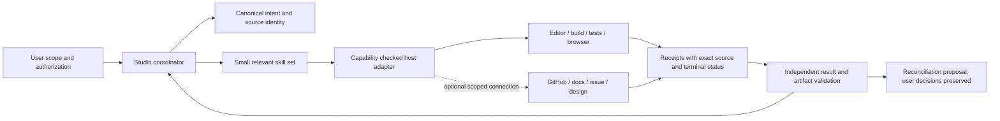

# Cross-plugin ecosystem audit (ECO-A through ECO-I)

Baseline: 29 October 2026, Asia/Tehran. This is a session-bounded inventory, not a complete marketplace survey. Discovery used the exposed tool catalog, cloud skill catalog, recommended-plugin catalog, `.app.json`, `capabilities.json`, `docs/integrations.md`, and actual local tool execution. No marketplace search, Plugin Creator tool, Plugin Management tool, provider account, IDE connector, or connected GitHub/issue/deployment API is exposed. No plugin was installed, connected, or activated. Names in the recommended catalog establish listing only. Pricing, current rate limits, provider retention, compatibility and supported write operations remain unknown until inspected. The user-mentioned creator/management plugins could not be evaluated or invoked.

## ECO-A — Actual availability inventory

| Candidate or category | Evidence and availability | Decision now |
|---|---|---|
| Software Architect Studio | Cloud skill `software-architecture` labels itself 0.7.2; repo toolkit 0.8.0 with manifests 0.7.1; inspected independently | KEEP coordinator; reconcile release identities |
| Cloud Environment | Status tool operational; configured restricted proxy; no application credentials bound | USE ALONGSIDE for runtime metadata; never application authority |
| Cloud Environment Onboarding | Draft tools exposed; existing prepared Python/browser dependencies retained | USE ALONGSIDE for environment setup only; no draft changes in this audit |
| Plugin Creator; Plugin Management | Explicitly requested; no callable tools or available skills; not in recommended install list | INVESTIGATE after tools are exposed; unavailable now |
| Native coding host | Shell, filesystem patching, local Python/Node/browser, genuine subagents actually available | INTEGRATE via host adapter proposal; actual host can edit, Studio cannot independently execute it |
| GitHub | Optional declaration in `.app.json`; HTTPS Git read tested; no GitHub connector tool | USE ALONGSIDE read-only Git now; conditional INTEGRATE for PR/CI later |
| Playwright + Chromium | Playwright 1.56.1 and installed system Chromium execute 4 tests | INTEGRATE receipt ingestion; maintain independent checks and traces |
| PyYAML/jsonschema/OpenAPI validator | Pinned declared primary packages installed and executed | BUILD IN adapter orchestration, reuse external libraries |
| Mermaid CLI | Declared optional adapter, `mmdc` missing | INTEGRATE installed renderer later; current render BLOCKED |
| Context7/official documentation | Docs propose it; no retrieval plugin available | INVESTIGATE; prefer versioned official docs, no guessed APIs |
| OpenAI Developers | Recommended listing only; identity `openai-developers@openai-curated-remote` | Optional companion for OpenAI-specific docs, exact tools unverified |
| Codex Security | Recommended listing only; identity `codex-security@openai-curated-remote` | Conditional security companion; do not replace testing/threat review |
| Figma | Recommended listing only; identity `figma@openai-curated-remote` | Optional design companion; cannot assume code export/design permissions |
| Linear | Recommended listing only; identity `linear@openai-curated-remote` | Conditional task sync after receipt/version conflict contract |
| Notion | Recommended listing only; `notion@openai-curated-remote` | Optional published documentation; project.json remains intent authority |
| Dropbox | Recommended listing only; `app-69b31dc2110c8191b8b47dc98fe5a052@openai-curated-remote` | Optional backup transport, not canonical state database |
| Box | Recommended listing only; `box@openai-curated-remote` | Optional artifact transport; defer until access/data needs known |
| SharePoint | Recommended listing only; `sharepoint@openai-curated-remote` | Optional organization documentation transport |
| Slack | Recommended listing only; `slack@openai-curated-remote` | Optional notifications; no messages authorized by this audit |
| Teams | Recommended listing only; `teams@openai-curated-remote` | Optional notifications; defer automatic dispatch |
| Gmail; Outlook Email | Recommended listings only; `gmail@openai-curated-remote`, `outlook-email@openai-curated-remote` | DO NOT ADOPT in core engineering path; optional explicitly requested delivery |
| Outlook Calendar | Recommended listing only; `outlook-calendar@openai-curated-remote` | DO NOT ADOPT in core; no demonstrated engineering gap |

Providers/maintainers of catalog-only plugins are not verified by their display names or namespace. No marketplace quality score is justified. Actual installed libraries and host tools have narrow observed functionality; successful local tests do not certify all versions/platforms.

## ECO-B — Capability gap matrix

| Gap | Native present | Proposed owner | Evidence needed before adoption |
|---|---|---|---|
| Multi-file application edits/builds | Planning instructions + contract validators only | Host coding adapter | Capability discovery, source/version checks, authorized diff, build/test receipts |
| UI behavior verification | Node DOM model + 4 browser tests | Browser runner | Traceable scenarios, real browsers, isolated contexts; accessibility assessment separately |
| Full code security | Threat instruction, path hardening, pattern redaction | Scoped security tools + human review | Exact language/rule coverage, safe fixture, dependency database date |
| Current framework API facts | Static references | Version-pinned docs companion | Provenance, version match, quoted relevant material; injection isolation |
| PR/CI continuity | Optional GitHub declaration | GitHub/CI provider | Read/write scopes, checks for exact commit, replay/conflict handling |
| Issues/docs | Local tasks/handoff files | Optional Linear/Notion/SharePoint | Provider IDs, source hash, idempotency and conflict behavior |
| Design files | Local architecture diagrams only | Optional Figma | Read scope, node/version references, export license/data handling |
| Deployment/operations | Design guidance, scenario calculators | Explicitly selected provider adapter | Environment identity, release authorization, checks/rollback; no provider selected |
| Database execution | Generated allowlisted in-memory SQLite checks | Optional selected DB runner | Ephemeral instance, migration rollback, tenant/auth tests; no live DB bound |
| Large-language semantic indexing | Python AST/narrow JS tokens | Language-specific adapters first | Coverage counters, unresolved semantics, useful benchmark gain |

## ECO-C — Candidate evaluation register and ECO-E compatibility

Serious candidates are the host coding adapter, browser runner, GitHub/CI, full schema validators, renderer, docs retrieval, security companion, and optional task/document/design adapters. The inventory above covers identity, observed purpose, availability and present decision. For every catalog-only candidate, connection requirements, exact tools/scopes, API schemas, documentation quality, reliability, cost/rate limits and operational recovery are **UNVERIFIED**. No opaque price or performance estimate is used. User account authorization and tool exposure are prerequisites; existing access to this repository via Git is not API or push authorization.

| Candidate | Incremental value and overlap | Exchange/ownership and compatibility | Security/privacy | Burden, recovery, validation |
|---|---|---|---|---|
| Host coding adapter | High: editing, build and runtime absent in Studio; preserve its planning role | Proposed versioned JSON change/check plans; Git commit+dirty hash and diff; native code authoritative for implementation | Host enforces filesystem/network scope; project text never grants rights | Medium; partial mutation requires inspection, never blind replay. Disposable app contract suite before use |
| Playwright | High UI behavior value beyond DOM model; already demonstrated | Existing JS tests; source hash + runner/browser versions + stdout/traces; no browser localStorage treated as central database | Disposable contexts, avoid production credentials; redact traces before sharing | Low-medium; rerun idempotent tests with fresh state, preserve failures. 4/4 current baseline pass |
| OpenAPI/jsonschema | High schema validation; overlaps structural checks appropriately | Existing Python workers; input file hash; precise schema/semantic scope | Offline refs policy, no ambient URL retrieval | Low; explicit missing/timeout/incomplete terminal states; known fixtures and invalid counterexamples |
| GitHub/CI | High cross-session source/check identity; Git transport only observed | Commit SHA and PR/check IDs, remote operations are provider-owned | Least privilege, treat PR text/logs as data, no token forwarding | Medium; conflict-aware optimistic write, query status before retry. Exact-operation read smoke then authorized sandbox write |
| Mermaid | Real rendering beyond heuristic lint; no runtime claim | Diagram input/hash and renderer version; generated image hash | Browser subprocess remains host sandbox responsibility; bound output/deadline/network | Medium; blocked parser is not success; install/version/security policy before fixture render |
| Docs retrieval/OpenAI Developers | Version accuracy vs stale prompt text | Retrieved section, authoritative URL/version/date; only selected excerpts | External text untrusted; no secrets sent in query | Low-medium; cite cached evidence with age or mark unknown; verify against versioned API fixture |
| Codex Security | Potential language/security depth; exact feature benefit unknown | Proposed minimized source/rules/report refs; Studio owns final synthesis, not automatic remediation | Source disclosure, token access, findings retention and false negatives require review | Unknown until inspect; no production security scans now; known vulnerable and clean fixture pair |
| Figma | Potential UI design context absent from architecture workbench | Design version/node IDs and asset references; design tool owns design | Team/asset scopes and sharing must be checked | Unknown; optional/manual asset fallback, prove accessible fixture design |
| Linear | Potential task continuity; overlaps local engineering tasks | Stable task IDs and source revision; issue status cannot overwrite accepted ADRs | Scoped workspace and authorized writes only | Unknown; dedupe/reconcile on retry; test duplicate delivery and user edits |
| Notion/SharePoint | Potential organizational documentation; overlaps exported handoff | Generation manifest/read_path and document IDs; explicit one-way publish first | Project/private history disclosure risk | Unknown; upload immutable versions, avoid automatic bidirectional merge, readback hash test |

Qualitative comparison direction: greater demonstrated value and lower cost/attack surface are preferable, but missing permission/schema evidence vetoes direct integration. No aggregate score conceals that veto. Core host/browser/validator tools have observed compatibility. All catalog-only plugins have unknown compatibility. Current local runtime is Python 3.12/Node 24; CI pins Python 3.12/Node 22, so CI equivalence is not established by local execution.

## ECO-D — Build versus integrate

BUILD IN: canonical intent validation, schema migration, expected-source preconditions, minimal intent/implementation reconciliation, coverage/readiness policies, reproducible evidence records. These require coherent local invariants and are already product strengths.

INTEGRATE: existing editors/runtimes/test runners, language analyzers, validators, renderer and selected CI. Reimplementing compilers, browsers, Git hosting or vulnerability databases creates unjustified maintenance. Standard CLI/file interfaces precede provider-specific plugins.

USE ALONGSIDE: IDE/coding host, optional issue tracker/docs/design tool, environment configuration. Avoid binding core project interpretation to an account or SaaS vendor.

DO NOT ADOPT: automatic broadcast messaging, calendar requirements, mandatory plugin bundles, parallel autonomous execution by default, universal graph/vector backend, multi-tenant hosted service without demand. These add costs/authority without closing a verified immediate gap.

## ECO-F — Proposed orchestration architecture

Example: incomplete application idea → clarify one material ambiguity while recording explicit assumptions → choose supported stack → requirement/contract slice → discover host capabilities → propose files/diff against exact source → authorized apply → build/unit/API/browser checks → ingest terminal receipts → reconcile implementation changes with ADRs/tasks → prepare handoff with unresolved blockers. Optional docs supply version facts; GitHub supplies actual CI; Linear receives only authorized task publications. If an integration is absent, export the same plan/check contract for manual execution and report BLOCKED or PARTIAL rather than pretending execution occurred.

## ECO-G — Integration security review

Assets: source/private requirements, credentials, accepted intent, tool authority, release identity, user time/cost. Crossings: user→coordinator, repo/docs→context, context→tool input, tool output→evidence, evidence→canonical state, export→provider. A project file or receipt never supplies authorization. Capability names are not authority grants. Serialize only allowed fields; reject unknown tool dispatch destinations; never interpolate repository text into shell. Compare exact source hash, scope and expected outputs; a self-reported passed receipt without checks is rejected. Provider logs/artifacts can contain secrets and require minimization; do not send the entire private project to every specialist or plugin. Unknown retention/cost prevents automated use. On partial writes, read resulting state, reconcile and ask only for genuinely new destructive authority. Revocation disables writes immediately and retains a manual fallback.

## ECO-H — Prioritized integration roadmap

1. P1: define and contract-test host editor/check-runner adapter; no SaaS dependency. Entry: stable evidence/readiness semantics. Exit: source mismatch rejects apply, timeout/partial writes preserved, fabricated receipt rejected.
2. P1: preserve working browser/schema adapters and expand negative checks; make CI and release identity truthful. Exit: exact commit/check attribution and invalid-fixture failures.
3. P2: inspect actual GitHub/CI and docs tool schemas when available, then use read-only proof. Exit: exact source/check/version retrieval; no implicit write.
4. P2: investigate security companion on disposable fixtures after data/permission review. Exit: known positive/negative cases and scoped coverage disclosures.
5. P3: optional issue/docs/design transport only after demonstrated user demand and idempotent sync contract. Exit: duplicate/conflict/revocation tests.
6. P4: hosted state/semantic service/multi-provider execution only after measured benefit, operational owner and user authorization. No current adoption commitment.

## ECO-I — Rejected, deferred, and unknown

Plugin Creator and Plugin Management remain inaccessible, not proven nonexistent. Marketplace coverage is incomplete. No comparative vendor quality/pricing claim is defensible. Context7 is repository-declared as a possible choice, not discovered installed. Email/calendar/messaging are excluded from the core because no current workflow needs them. Hosted multi-user state, universal indexing and autonomous multi-model orchestration remain deferred, consistent with M38–M40. Conditional candidates require fresh schema/permission checks each session; this document never authorizes their installation or external writes.
