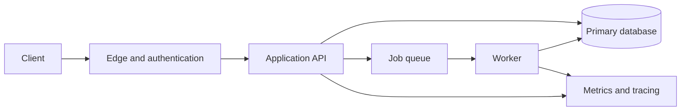

# Architecture design document framework

Choose the shortest version that matches the request. A conversational answer may be one page; a stakeholder-facing design may use the full outline.

## One-page architecture brief

1. Problem and recommended approach (2–4 sentences).
2. Requirement/constraint table: item, priority, source (provided vs assumed), validation.
3. Logical components and the roles each plays; Mermaid diagram when appropriate.
4. One critical end-to-end journey from ingress through services/storage, plus failure handling.
5. Major technical decisions and rejected alternatives (with measurable trade-offs).
6. Security, privacy, operations and cost caveats.
7. Three principal risks, open questions and build/validation milestones.

## Full design dossier

- **Context and stakeholders:** goals, business outcomes, use cases and users.
- **Scope:** core capabilities, explicitly excluded features and external systems.
- **Quality attributes:** availability, scalability, privacy, recovery, latency, maintainability and cost objectives. Use targets only when provided or labeled provisional.
- **Assumptions:** include confidence and the design that would change if false.
- **Architecture at multiple levels:** system context, containers/deployable units, component responsibilities, critical sequences, trust boundaries. Use C4-inspired names, not necessarily C4-specific syntax.
- **Domain/data model:** entities, source of truth, ownership, storage types, access/query patterns, state transitions, indexes, migrations, archival and retention.
- **API and event contracts:** key resources, authentication, validation, pagination, versioning, quotas, errors, idempotency keys, event schema evolution and observability IDs.
- **Cross-cutting concerns:** authorization, compliance where applicable, secrets, encryption, auditability, performance, caching, async orchestration, failure domains, consistency, observability and operational ownership.
- **Infrastructure/deployment:** environments, regions/data locality, CI/CD, rollbacks, secrets, disaster recovery and backup restore tests.
- **Alternatives:** decision matrix, benefits, drawbacks, complexity and migration triggers.
- **Risks and testing:** threat model, spike/load test strategy, chaos/failure tests, security tests, canary rollout, acceptance criteria.
- **Roadmap:** MVP, scale-out inflection points, owners and decision gates.
- **ADRs:** attach for major irreversible or costly decisions.

## Example Mermaid skeleton

The skeleton is illustrative, not a fixed recommendation. Replace names and links with those appropriate to the user's system. If a diagram is speculative, label it a proposal. For sensitive flows annotate trust boundaries and identity propagation.
