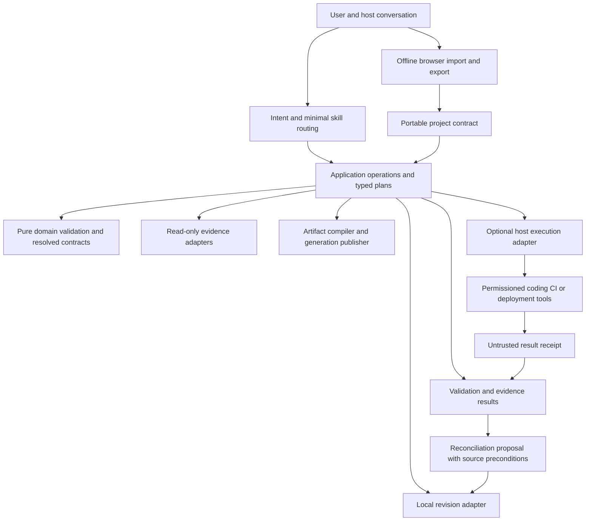

# Expert 02 — Supporting architecture maps and migration notes

Independent first-pass supporting material for expert02.md, same frozen baseline and limitations. All target elements are proposals; nothing was implemented.

## Baseline architecture and strengths

The deployed topology established by source is a plugin containing seven instruction skills, a separately invoked Python CLI and a separately opened offline browser workbench. The plugin manifest declares an optional host GitHub connector; there is no native execution service in the manifest (`plugin.json:31–46`, `.app.json:2–6`). Instructions can direct an available host, but do not turn the local toolkit into a model runner or developer platform.

| Boundary | Observed ownership and evidence | Inputs / outputs / failures |
|---|---|---|
| Host conversation and skills | Intent/depth/audience instructions, architecture reasoning and specialist routing; `skills/software-architecture/SKILL.md`; six companion skills | User request and supplied evidence → proposals; host availability/permissions remain external |
| CLI application facade | 34 subcommands; direct dispatch in `tools/architect_cli.py:25–102` | Paths/options → JSON result; most input errors → generic JSON error, with an observed exception gap |
| Project domain | Draft records, typed relationships, reference integrity, supersession and resume; `tools/project_model.py:7–16,23–109` | Mutable JSON object → issues or validated object; unknown fields retained |
| Change analysis | Typed association/relationship graph, deterministic traversal/witness paths; `tools/graph_engine.py:6–63` | Baseline/proposal or changed requirements → delta and review candidates; no semantic causality claim |
| Local revision storage | Expected hash, cooperating lock, prepared/committed journal, immutable prior revisions; `tools/revision_store.py:24–112` | Canonical object → atomic project replacement plus recoverable projections |
| Artifact compiler | Native OpenAPI or per-interface operation projection, tasks/ADRs/data/diagrams, readiness; `tools/artifact_compiler.py:9–120` | Canonical object → artifact plan; errors before normal publication |
| Publication storage | Immutable generation, manifest and atomic pointer, recoverable legacy files; `tools/artifact_compiler.py:122–175` | Plan → generation path; incomplete projections are explicitly reported |
| Repository evidence | Budgeted static read-only adapters; `tools/repository_evidence.py:83–174` | Regular files → identities/declarations/omissions; no repository execution |
| Validation | Built-in integrity/contract checks plus optional bounded worker processes; `tools/validation_engine.py:89–189,203–341` | Files → per-check terminal results and separate gate decision |
| Offline workbench | Independent JS domain implementation and browser persistence; `workbench/project-core.js:3–52`, `workbench/index.html:30–71` | Import/edit → current canonical project and private flat snapshots; no CLI invocation bridge |
| Integration contracts | Capability and verification envelope validation only; `tools/integration_contracts.py:1–5,26–116` | Supplied records → issues; no discovery/invocation/permission enforcement |

An AST import inspection of all 16 Python modules found 39 local import edges and no cycle, including imports inside functions. This is a static result for these modules, not proof of absence of dynamic/runtime coupling. There are 1,824 Python physical lines, heavily compressed in several modules. The UI has 72 HTML physical lines and 53 JS physical lines; these counts substantially understate logical complexity because many statements share lines.

Preserve these strengths:

- A canonical draft and independent readiness dimensions are more honest than claiming that a parsed document is an implementation specification (`project_model.py:23–82`; `artifact_compiler.py:31–34`).
- Atomic `project.json` replacement and recoverable human history are an appropriate local consistency model. The implementation validates recovery payload hashes and refuses committed-journal/current-state mismatches (`revision_store.py:24–35,50–67`).
- Generation publication distinguishes an authoritative immutable path from convenience projections and checks human modifications before replacement (`artifact_compiler.py:122–175`).
- Filesystem primitives bound reads, reject special files, and use descriptor-relative no-follow operations on POSIX (`safe_io.py:20–116`). Their documented cooperating-writer and durability limits are appropriate.
- Graph witnesses are expressly review candidates, not proof of mandatory code changes (`graph_engine.py:39–45`). Scanner omissions and unsupported languages are disclosed (`repository_evidence.py:140–159`).
- External execution remains opt-in and host dependent. The implementation-adapter document explicitly says it is not a connected adapter (`docs/implementation-adapter.md:2–6`).

## Proposed target: a modular local core with optional host execution

This is a design proposal, not implemented functionality. Separate trust boundaries and data authority while preserving local-first use.

Mermaid source above was authored but not rendered: `mmdc` is unavailable. Boxes describe proposed responsibilities; they do not claim a hosted app, installed integration or active service.

| Required layer | Current → target responsibility, interface and failure behavior |
|---|---|
| 1. User interaction/project entry | Host and offline UI → keep quick advice file-optional; portable draft import validates before replacing state |
| 2. Intent classification | Skill instruction → declarative task/depth/audience selection; ambiguity produces bounded assumptions, not a compulsory interview |
| 3. Requirements/specification | Core JSON records → same IDs with sourced acceptance and explicit applicable obligations; invalid patches refused |
| 4. Workflow planning | CLI worksheets and host reasoning → small typed `OperationPlan` for consequential workflows; unsupported steps marked blocked |
| 5. Skill registry/routing | Seven skills/instruction routing → lightweight catalog of purpose, inputs, outputs, evidence and exclusions; no registry service |
| 6. Reasoning/review | Host dependent → optional host specialists for requested high-risk review with actual counts/clean baseline; ordinary tasks stay single flow |
| 7. Project knowledge/state | JSON canonical intent → versioned contract plus extensions; observed source and model proposals remain separately labeled |
| 8. Repository intelligence | Bounded static scanner → preserve extraction bounds and add source-ref/dirty-overlay identity at host seam; partial scope remains visible |
| 9. Tool orchestration | Documented protocol only → one optional capability/result adapter with per-operation authorization and conflict handling |
| 10. Implementation | External host work → pass constraints, source identity and check plan; receive reviewable diff and actual execution evidence |
| 11. Artifact generation | Pure-ish compiler plus publisher → resolved contracts consumed once; generation and projection commits remain separate |
| 12. Validation/evaluation | Independent gates → equivalent draft contract checks, typed terminal results, source-bound verification and separate semantic review |
| 13. Security/permissions | Host boundary and IO controls → preserve host authority; minimize per-adapter context; repository text is never executable permission |
| 14. Developer integrations | Conditional GitHub/contract docs → optional selected host adapter; availability/version checked before dependent plans |
| 15. History/recovery | Local journals/flat browser snapshots → keep documented local semantics; explicit ID/fork policy and budget preflight |
| 16. Delivery/handoff | Immutable generations → coherent reader path and exact artifact hashes; blocked/partial completeness is explicit |
| 17. Observability | Optional minimized summary → source-bound operation/check receipts plus separate privacy-minimized run accounting; no raw prompt logging by default |
| 18. Configuration/extensibility | CLI flags and constants → versioned local `ExecutionPolicy` with bounded defaults and explicit optional validators; unsupported policy fails closed |
| 19. External delegation | Documentation/schema → optional invocation through actual host tools; validate capability/result schemas, availability and source identity each workflow |

The 19 layers are responsibilities, not 19 services or mandatory artifacts. Local CLI and browser remain usable without integrations. The core should not rebuild Git hosting, CI, browsers, documentation retrieval or deployment providers.

## Interfaces and invariants for implementation handoff

The following shapes are proposed internal contracts; they need schema design and tests in the subsequent authorized implementation phase.

- `ProjectIdentity {project_id, schema_version, revision, canonical_hash}`; `SourceIdentity {adapter, repository_ref, commit?, dirty_overlay_hash?, observed_files_hash, captured_at, scope}`. A project revision and source revision are different identities.
- `validate_project(document) -> Issue[]`; `resolve_contracts(document) -> {resolved_interfaces, provenance, conflicts, applicability}`. Pure functions, no retrieval or execution. `Issue {code, severity, location, source_identity?, detail}`.
- `plan_change(baseline, proposed, policy) -> {typed_delta, impact_seeds, witnesses, obligations, expected_project_hash, expected_source_hash?}`. Connectivity is review scope; generated tasks never automatically prove satisfaction.
- `ProjectStore.commit(proposal, expected_hash, change_message) -> CommitReceipt`; identity changes require a distinct operation. Serialize/preflight all payloads before effects. Canonical replacement stays the commit point; retry/recover reconciles observed state.
- `compile(project, resolved_contracts, profile, disclosure_profile) -> ArtifactPlan`; `ArtifactPlan {files, canonical_input_hash, compiler_context_hash, exported_project_hash, transformation_paths, readiness}`. `Publisher.publish(plan) -> {generation_id, read_path, projection_status, manifest_hash?}`. Do not claim cross-file atomicity.
- `ExecutionAdapter.capabilities/inspect/propose_change/apply_change/run_checks/recover` follows the documented ownership split. Every consequential call requires actual host authorization; adapter receipts are untrusted data to validate, not proof of permission or authenticated truth.
- `OperationResult {operation_id, status, input_identity, output_identity?, checks[], artifacts[], errors[], limitations[], partial_effects[], recovery_hint?}`. Status enum is finite; no generic `completed` becomes `tested` or `deployed`. Check freshness by source identity before making a verification current.

A proposed request-to-delivery flow is: classify minimum workflow → load exact project/source identities → validate/resolve → prepare typed change/check plan → use available authorized host adapter → validate receipt and freshness → produce reconciliation proposal → apply expected-hash local commit when authorized → compile immutable generation → independently validate outputs. A failure before external effect is failed/blocked; a failure after partial effect is partial with recovery information, never silently retried as a fresh operation.

## Alternatives, trade-offs and migration

| Option | Advantages | Material costs/risks | Decision |
|---|---|---|---|
| Incremental repairs within current modules | Lowest compatibility risk; addresses observed defects rapidly | Continued duplicated policy if no shared metadata/resolver follows | **First:** repair P1s using characterization cases |
| Targeted internal package refactor | Clear contract authority, testable pure logic and adapter boundaries; keeps local deployment | Temporary compatibility facades and fixture migration | **Recommended target**, one seam at a time |
| Full rewrite / unified browser-Python runtime | Could remove some duplication | Reimplements mature recovery/IO safety; new runtime/tooling; no demonstrated user benefit | Reject for current scope |
| Hosted multi-user service / microservices | Could support shared collaboration if proven needed | Auth/tenant isolation, migrations, operational SLOs, cost and distributed recovery | Defer until repeated collaboration demand and operating ownership exist |
| Universal orchestration/graph platform | Broad extensibility in theory | Permission/version/schema combinatorics and weak evidence semantics | Reject now; prove one adapter and explicit graph use first |

No benchmark or financial estimate was made. Incremental repair has the strongest evidence-to-effort ratio; package refactoring should be measured by fewer divergent policies and safer change, not more abstractions.

**Migration initiatives and dependencies:**

1. **E02-I01 Contract integrity** addresses R01/R03/R04/R06. Preserve current v2 files and add counterexample fixtures; build resolver/metadata and explicit identities without rewriting existing content. Acceptance A01/A03/A04/A06; prerequisite for stronger orchestration. Rollback retains old CLI package and exact canonical files; new exports must remain version identified.
2. **E02-I02 Persistence and error boundary** addresses R02/R07/R08. Preflight serialized operations, typed adapter failures and project identity policy; retain current commit point and recovery model. Acceptance A02/A07/A08 plus recovery-failure tests. No need for a database migration unless the storage model changes later.
3. **E02-I03 General change analysis and core boundaries** addresses R05/R10 after characterization fixtures exist. Introduce typed seeds and optional-record output; maintain requirement-only CLI compatibility. Acceptance A05/A10; preserve existing JSON fields or version any changed output shape.
4. **E02-I04 One execution integration** addresses R09 after I01/I02. Start read-only inspection/propose/check receipts on a fixture project; add actual apply only with permissions and recovery semantics. Acceptance A09; fall back to prepared artifacts/manual tool use when adapter is missing. A later provider needs evidence of demand and compatibility, not a generic plugin-count target.

None of these initiatives was implemented during the audit.

